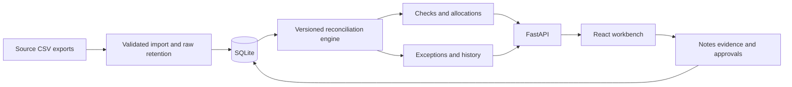

# Reconcile

Reconcile checks orders, payments, processor payouts, bank deposits, and ledger entries. It gives finance teams a queue for investigating differences and recording review decisions.

**[Open the public demo](https://at-2201.github.io/transaction-reconciliation/)** · Read-only · Synthetic data · No sign-in

| Public demo | Full local app |
| --- | --- |
| Browse a completed reconciliation run, filter match results, search exception cases, inspect source evidence, and export cases to CSV. | Import CSVs, run reconciliation, assign cases, add notes and evidence, and approve or close cases as the appropriate role. |

The hosted demo shows saved results from the bundled NovaCommerce dataset. Customer names, markets, and payment institution names are fictional. A separate context file adds those labels and sales channels to the interface. Use the local app to try the reviewer and approver workflow.

## Run the full app locally

Requires Python 3.12+ and Node.js 20.19+ or 22.12+.

```bash
bash scripts/start.sh
```

Open [the workbench](http://127.0.0.1:8000). Choose **demo approver** to import, run checks, and approve cases, or **demo reviewer** to investigate and annotate. Interactive API documentation is at [API docs](http://127.0.0.1:8000/docs).

The script installs dependencies, builds the frontend, imports the baseline without duplicating existing records, and runs reconciliation. Your database and immutable raw imports live under `data/`. Notes, approvals, and previous runs persist across restarts. Rejected rows are recorded and visible in the dashboard. Imports do not automatically trigger reconciliation.

Alternative: `docker compose up --build` starts the same application with a persistent volume and binds it only to localhost. The Docker configuration is supplied but must be verified on a machine running Docker.

## Features

- Overview with stage completion, pending settlements, open cases, and flagged variance.
- Four independent checks: orders to captures, processor activity to payouts, payouts to bank, and bank cash movements to accounting.
- Signed integer-cent arithmetic, exact references, compatible statuses, currency and account checks, weekday date windows, and conservative review candidates.
- Filterable/searchable exception queue, CSV export, source evidence, assignments, notes, supporting attachments, and case statuses.
- Session cookies, server-enforced reviewer/approver permissions, evidence requirements, and a case-owner approval restriction.
- CSV source import with exact headers, validated fields, stable-identity deduplication, immutable conflicting records, retained raw files and checksums, and row-level quarantine.
- Versioned run snapshots and allocations; reruns preserve decisions and review history. Concurrent stale case edits return a conflict.
- Materially changed findings reopen previously closed cases and invalidate an earlier match decision, while retaining the approval audit history.
- Late evidence import can clear a source finding while leaving case closure to a reviewer.
- Source explorer, run history, held-out scenario evaluation, API documentation, automated tests, and a container setup.

## Local walkthrough

1. Enter as demo approver. The baseline has **10,360 checks**, **10,040 reconciled**, **68 review cases**, **50 partial orders**, **200 ineligible orders**, and **2 pending payouts**.
2. On **Overview**, filter the **Case queue** by stage and select a case.
3. Inspect **Evidence**. In **Review**, assign the case to the demo reviewer. Add a note in **Activity**.
4. Attach the matching source CSV (or retained imported file) and record identifier, explain what it demonstrates, and update the status. An active difference requires evidence before resolution.
5. For missing-reference or ambiguous bank candidates, select the verified bank transaction and approve as an approver who is not the assigned owner. Approval records a decision; it does not change source data or move funds.
6. On **Overview**, open **Imports**, select processor transactions, and import `datasets/fixtures/replay/processor_transactions_replay.csv`: expect 100 duplicates and zero new events. Import the invalid fixture separately: expect four quarantined rows.
7. Select payout items and import `datasets/fixtures/late_evidence/missing_payout_items.csv`, then rerun. The two affected composition findings clear; notes and cases remain available for closure.

Do not use the baseline evaluator after applying amendments and expect baseline labels to remain correct. Evaluate a fresh baseline database separately, as the tests do.

## Architecture



SQLite with foreign keys and WAL is the working local database. The dataset's PostgreSQL source schema remains in `datasets/documentation/schema.sql`; this application does **not** yet provide a PostgreSQL runtime adapter. A database migration/adapter and concurrency testing are needed before that deployment choice. The runtime schema is maintained in `app/db.py`, and all four matching stages are in `app/engine.py`. The engine never reads evaluation labels.

The initial project deliberately follows the guide's educational V1. It is a functioning local application, not a production financial integration. Real provider adapters, SSO, per-user credentials, organization isolation, managed secrets, holiday calendars, production migrations, backups, job scheduling/monitoring infrastructure, FX, invoice allocation, and accounting posting are not included. Daily scheduling can invoke the CLI; automatic scheduler installation is not performed.

## Development and testing

```bash
.venv/bin/python -m pip install -r requirements-dev.txt
.venv/bin/python -m pytest -q
.venv/bin/python -m app.cli evaluate
```

The evaluator compares status, expected amount, observed amount, and variance for every baseline check, including the 2,062 holdout checks. It fails for missing, extra, or incorrect checks. Tests create isolated temporary databases and exercise imports, conflicts, quarantine, permissions, approval controls, evidence, reruns, and late amendments. The evaluation dataset labels are never loaded into the application database.

Useful commands:

```bash
.venv/bin/python -m app.cli seed
.venv/bin/python -m app.cli run --as-of 2026-11-05
.venv/bin/python -m app.cli evaluate
.venv/bin/python -m uvicorn app.main:app --host 127.0.0.1 --port 8000
```

For frontend development, run the API on port 8000 and `npm run dev` from `frontend/`; Vite proxies `/api`. Use the Vite address for the entire frontend session. Build with `npm run build` and restart the API if `frontend/dist` was created after the API started.

## API

All financial/workflow endpoints require a session from `POST /api/login`; health and sign-in are public. JSON API paths use `/api`:

| Endpoint | Purpose |
|---|---|
| GET /reconciliations/summary | Overview and stage counts |
| GET /exceptions | Search, filter, and paginate cases |
| GET /exceptions/{id} | Source records, attachments, decisions, audit history |
| POST /exceptions/{id}/notes | Add investigation note |
| POST /exceptions/{id}/assign | Change owner |
| POST /exceptions/{id}/status | Record workflow transition |
| POST /exceptions/{id}/evidence | Attach a verified source-file reference |
| POST /matches/{id}/approve | Approve a proposed bank match |
| GET /checks | Latest check results |
| GET or POST /runs | Run history or execute a new run |
| GET /runs/{id} | Specific run details |
| GET /sources/{table} | Source explorer |
| GET /imports | Import history |
| POST /imports/{table} | Import a CSV upload |
| GET /imports/{id}/rejections | Quarantined rows |
| GET /exports/exceptions.csv | Export case queue |

Case mutations require the latest `version` and a note. Approvals require an allowed candidate, evidence, a different case owner, and an unallocated bank credit. Source mutations through CSV are append-only; existing conflicting identifiers are quarantined rather than overwritten.

## Configuration

| Variable | Default | Purpose |
|---|---|---|
| RECON_DB | data/reconciliation.sqlite3 | Local database file |
| RECON_DEMO | 1 | Enables simulated role sign-in |
| RECON_PASSWORD | unset | Shared local workspace password when demo mode is disabled |
| RECON_SECURE_COOKIES | 0 | Set 1 only behind HTTPS |
| RECON_ALLOWED_HOSTS | localhost,127.0.0.1,testserver | Explicit allowed HTTP hosts |
| PORT | 8000 | Port used by start.sh |

Demo role selection is intentionally open and must stay local. Disabling demo mode adds a shared-password gate, not production identity management. Deploying outside localhost needs real authentication and infrastructure controls. No real credentials, card data, money movement, or ledger posting are involved.

Flagged variance adds absolute case differences across stages and is **not a loss estimate**. An unresolved missing observation has unknown variance. Identical underlying issues can appear at more than one stage. All money is USD cents; holiday calendars are simplified to weekdays. Capture reconciliation excludes authorizations and later refunds, while payout reconciliation includes signed settlement events.

See `datasets/README.md` for scenario details and `datasets/documentation/data_dictionary.csv` for source fields.
