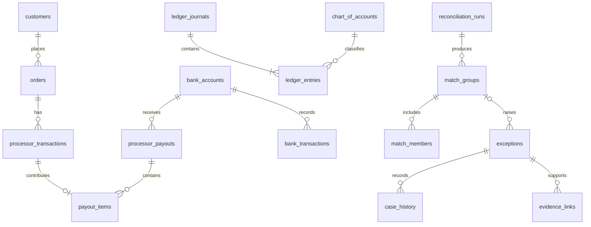

# Data model

Source ownership: storefront supplies orders; processor supplies events, payout headers, and payout membership; bank supplies movements; ledger supplies journals and lines. Source namespace plus identifier defines external identity. This V1 has one source instance of each kind.

Payout-to-bank is inferred by the engine, not stored as a source foreign key. Journal reference identifies the processor event or bank movement recorded; use match groups to record validated links. Payment fees are separate events. Captures can be split across an order; refunds retain their original capture reference and settle in a later payout.

Match member role distinguishes expected and actual sides. Stage lives on the group. A source amount may participate across stages but must not be overallocated within the same stage and side. Polymorphic source links need explicit validation in your engine. The supplied SQL is a starting schema, not a complete production control implementation.
